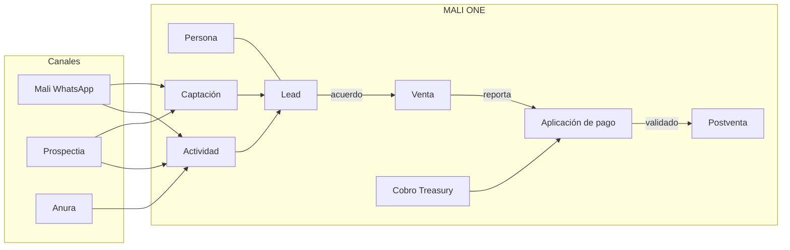

# Checklist de ratificación — CRM Educación

**Uso:** revisar con asesor, jefe y Caja. Marcar cada ítem cuando todos lo describan igual.

**Regla de producto:** si hay que cambiar el rumbo, se edita solo el
[modelo operativo](./modelo-operativo.md). Esta checklist y los anexos técnicos
se alinean después; no redirigen el producto por su cuenta.

**Leyenda**

| Marca | Significado |
|-------|-------------|
| ☐ | Pendiente de acuerdo |
| ☑ | Acordado (anotar fecha / quién en la reunión) |
| As is | Cómo opera hoy (código + política vigente) |
| To be | Lo que el modelo operativo propone |

---

## 0. Gráfico del modelo ideal (grosso modo)

Lectura en una frase: los canales aportan captaciones y toques; ONE concentra
persona + lead; el acuerdo crea la venta; el cobro de Treasury se aplica a esa
venta; postventa (matrícula / boleto) va aparte.

---

## 1. Vocabulario — ¿decimos lo mismo?

| Concepto | As is | To be | ☐ |
|----------|-------|-------|---|
| Unidad comercial | Ciclo / oportunidad WA + `EducacionOpportunity` ONE; nombres mezclados | **Lead** (negocio); ciclo = su recorrido; código puede seguir diciendo `Opportunity` | ☐ |
| Persona | Contactos en WA/Prospectia; `EducacionPerson` en piloto | Identidad en ONE; contactos = proyecciones por herramienta | ☐ |
| Cliente | No hay definición de negocio única; se habla de venta/pago/ciclo | Propuesta del modelo: comprador con ≥1 pago **validado** (abono ≠ saldo total ≠ matrícula) | ☐ |
| Etapa vs chat | Asesor comercial ≠ responsable del chat (ya documentado) | Igual: cubrir chat no mueve propiedad ni comisión | ☐ |

---

## 2. Herramientas — ¿quién hace qué?

| Pieza | As is | To be | ☐ |
|-------|-------|-------|---|
| Mali WhatsApp | Mensajería + **motor comercial global** (ciclos, etapas, SLA) | Superficie del asesor; pide cambios a ONE; no es el escritor comercial definitivo | ☐ |
| Prospectia | Ingreso maestro en ONE; estado local / Chatwoot | Igual en captura; estado externo no pisa la etapa comercial de ONE | ☐ |
| Anura | Toques / CDRs; match a persona/oportunidad; no abre ciclo solo | Actividad del lead; abrir lead solo con consulta comercial reconocida o regla explícita | ☐ |
| MALI ONE | Bandeja/ficha, Prospectia, ventas/pagos, shadow; autoridad global aún no | Escritor de persona, lead, etapa, venta; módulos Personas / CRM / Catálogo / Treasury / Postventa | ☐ |

---

## 3. Recorrido interés → cliente

| Paso | As is | To be | ☐ |
|------|-------|-------|---|
| 1. Recibir interés | WA crea/actualiza ciclo; Prospectia abre en ONE; medios no unificados del todo | Captación → ONE identifica persona (o provisional) → abre/continúa **un** lead; sin asesor también se guarda | ☐ |
| 2. Asignar y atender | Assign/review WA + bandeja ONE; Anura como lateral | Regla o jefe asigna; reclamo si libre/elegible; todos los toques al mismo lead | ☐ |
| 3. Resolver preventa | `venta_exitosa` = compromiso; **ciclo sigue abierto** hasta pago / sin pago / pérdida (Option A) | Acuerdo → cierra lead como venta exitosa **y** crea **una** venta; cobro no cierra la preventa | ☐ |
| 4. Reportar pago | Asesor asocia código/comprobante (WA y/o ONE) | «Reportado»; no cambia precio ni dueño ni declara saldo pagado | ☐ |
| 5. Validar y aplicar | Caja / associate con reglas Treasury; positivo o Autorizada puede cerrar ciclo hoy | Caja valida operación; aplica sin duplicar; parcial/total/obs; cierre comercial ya ocurrió en el paso 3 | ☐ |
| 6. Postventa | Boleteo OBS→boleteado + ref matrícula en UI Pagos | Matrícula y documento separados; se habilitan con requisitos acordados; uno no implica el otro | ☐ |

---

## 4. Decisiones abiertas (solo se cierran en el modelo operativo)

Rellenar el valor acordado; luego volcar al [modelo operativo](./modelo-operativo.md).

| Decisión | Hoy | Propuesta en modelo | Valor acordado | ☐ |
|-----------|-----|---------------------|----------------|---|
| **X** (lead distinto) | Sin valor de negocio único | Inactividad efectiva si abierto; desde cierre si cerrado; tiempo solo no crea lead vacío | _______ | ☐ |
| Nuevo interés tras cierre | Depende del medio / práctica | Abre lead nuevo aunque no haya pasado X | _______ | ☐ |
| Interés distinto con lead abierto | Ambiguo | Revisión humana; compras independientes solo con jefe | _______ | ☐ |
| Definición de **cliente** | Implícita / variable | Pago validado a una venta del comprador | _______ | ☐ |
| Habilitación matrícula / boleteo | Práctica Caja + UI refs | Requisitos explícitos (pago / datos / sin obs bloqueantes) | _______ | ☐ |

---

## 5. Cinco ejemplos (probar en voz alta)

Para cada uno: ¿as is qué haríamos hoy? ¿to be qué debería pasar según el modelo?

| # | Escenario | As is (anotar) | To be esperado | ☐ |
|---|-----------|----------------|----------------|---|
| 1 | Compra normal (interés → acuerdo → pago total → postventa) | | Un lead → una venta → aplicaciones → matrícula/boleto | ☐ |
| 2 | Misma persona captada otra vez por otro medio, misma negociación | | Misma lead; nueva captación/actividad; no segundo lead | ☐ |
| 3 | Retorno tras X de inactividad | | Cierre del anterior si aplica + lead nuevo vinculado | ☐ |
| 4 | Nuevo interés justo después de cerrar (sin esperar X) | | Lead nuevo de la misma persona | ☐ |
| 5 | Pago parcial / con observación | | Venta sigue; saldo parcial; cliente según def. acordada; sin matrícula automática | ☐ |

---

## 6. Quién responde (smoke de roles)

| Acción | As is (aprox.) | To be (modelo §4) | ☐ |
|--------|----------------|-------------------|---|
| Abrir/conservar lead | WA / Prospectia ONE | Sistema + captación; no bloquea por falta de asesor | ☐ |
| Etapa y cierre comercial | Asesor en WA | Asesor propietario; ONE escribe | ☐ |
| Asignar / corregir / conflictos | Jefe (WA + bandeja) | Jefe | ☐ |
| Validar cobro | Caja | Caja; no cambia etapa ni se apropia de la venta | ☐ |
| Matrícula | Admin académica / práctica actual | Admin académica, con requisitos | ☐ |
| Documento / boleto | Caja | Caja | ☐ |

---

## 7. Cierre de la reunión

| Ítem | ☐ |
|------|---|
| Todos describen igual: consulta, lead, venta, pago | ☐ |
| Decisiones de la §4 volcadas al modelo operativo (o dejadas explícitamente abiertas allí) | ☐ |
| Nada del anexo de propuestas se tomó como política sin pasar por el modelo | ☐ |
| Próximo paso técnico acordado: mapear piezas al código (reutilizable / ajustar / ausente) sobre esta ruta | ☐ |

**Fecha:** ____________  
**Asesor:** ____________  
**Jefe:** ____________  
**Caja:** ____________  
**Notas:**
